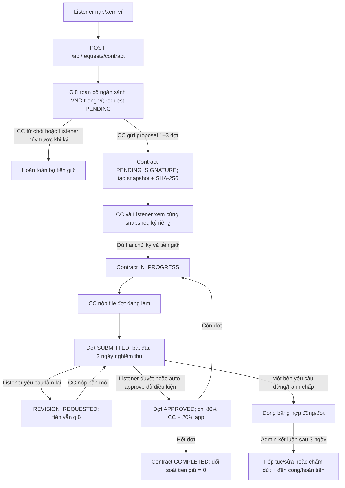

# Luồng hợp đồng Listener đặt CC sản xuất audio/video

Tài liệu này giải thích chức năng chạy theo thứ tự nào và tiền đi đâu. [Hướng dẫn Frontend gọi API](CONTRACT_API_GUIDE.md) chứa URL, body, response. [Mẫu hợp đồng](CONTRACT_TEMPLATE.md) là nội dung được đóng gói để tạo snapshot ký.

## 1. Các bên và điều khoản

Listener chọn ngân sách VND, đặt CC làm một sản phẩm audio/video. CC đề xuất **1–3 đợt**; tổng tiền các đợt phải đúng ngân sách. Mỗi bản bàn giao cho Listener **3 ngày** nghiệm thu; Listener có tối đa **3 lượt yêu cầu làm lại mỗi đợt**. Đợt được duyệt: CC nhận **80%**, nền tảng **20%** trong ngân sách đã giữ. Nếu chấm dứt hợp lệ và Admin xác nhận bản nộp đợt hiện tại đạt tiêu chí tối thiểu, khoản đền công gộp bằng **30% đợt đó**, phí app **10% của khoản đền công** (trừ từ phần CC), hoàn phần còn lại cho Listener. Tranh chấp ưu tiên thương lượng **3 ngày**. Listener chỉ sử dụng và đăng tải sản phẩm đã nghiệm thu, thanh toán đủ cho mục đích **phi thương mại**.

## 2. Luồng request hợp đồng có giữ tiền

### Tạo và giữ ngân sách

Listener nhập tên, mô tả, kênh CC, AUDIO/VIDEO, định dạng file, thời lượng, tiêu chí nghiệm thu, ngân sách và tùy chọn tự nghiệm thu. `POST /api/requests/contract` khóa ví Listener, chuyển đúng ngân sách từ `availableBalance` sang `heldBalance`, lưu request và bút toán trong một transaction. Không đủ tiền thì toàn bộ thao tác thất bại. `idempotencyKey` giúp retry cùng nội dung không giữ tiền lần hai. Nếu CC từ chối hoặc Listener hủy trước khi ký, Backend hoàn tiền giữ vào số dư khả dụng và đóng đề xuất đã có.

### CC đề xuất và hai bên ký

CC gửi 1–3 đợt có tên, mô tả, hạn nộp tăng dần và tiền. Backend kiểm tra tổng bằng ngân sách đã giữ, tạo `Contract PENDING_SIGNATURE`, lưu snapshot hợp đồng và hash SHA-256. Listener và CC đọc cùng `contentSnapshot`, ký bằng phiên bản/hash đã xem. Backend lưu thời điểm từng bên ký. Chỉ khi đủ hai chữ ký và tiền giữ vẫn đủ, hợp đồng mới `IN_PROGRESS`. CC chưa thể nộp file trước thời điểm này. API `/accept` cũ bị chặn đối với request có escrow.

### CC bàn giao, Listener phản hồi

CC nộp file audio/video cho đợt hiện tại; Backend lưu object key riêng tư và các lần nộp. Listener hoặc CC lấy URL xem file có chữ ký R2, hiệu lực khoảng 5 phút. Chỉ được nộp đợt tiếp theo sau khi đợt trước `APPROVED`.

Khi đợt `SUBMITTED`, Listener chọn:

1. **Duyệt:** Backend trừ tiền gộp của đợt khỏi ngân sách giữ một lần, cộng phần ròng vào ví CC, ghi phí nền tảng và các bút toán; `Payment PAID`. Listener không trả thêm.
2. **Từ chối bản bàn giao hoặc yêu cầu sửa:** Phải có lý do; đợt `REVISION_REQUESTED`, tiền vẫn giữ. CC làm lại và nộp bản mới; đồng hồ 3 ngày bắt đầu lại từ bản mới. Tổng cộng tối đa 3 lượt Listener yêu cầu trên mỗi đợt. Từ chối bản nộp không tự chấm dứt hợp đồng hay trả đền công.
3. **Tranh chấp:** Đợt `DISPUTED`, không tự nghiệm thu. Admin có thể yêu cầu CC sửa hoặc duyệt đợt sau thời gian ưu tiên thương lượng khi áp dụng escrow.

Nếu Listener đã chọn `autoAcceptEnabled=true` từ lúc tạo request, job Backend kiểm tra mỗi phút. Job chỉ tự duyệt sau **3 ngày** kể từ bản nộp mới nhất khi đợt vẫn `SUBMITTED`, hợp đồng đang hiệu lực, không có phản hồi/từ chối/sửa hay tranh chấp. Nếu `false`, không tự duyệt.

Ví dụ đợt **20.000 VND** được duyệt: CC nhận **16.000 VND**, app nhận **4.000 VND**. Tiền VND nguyên được làm tròn phí theo `HALF_UP`; phần CC bằng tiền gộp trừ phí, nên tổng luôn khớp.

### Dừng hợp đồng, đền công, hoàn tiền

Listener hoặc CC tạo yêu cầu chấm dứt. Hợp đồng chuyển `DISPUTED`, các bước nghiệm thu/giải ngân bị chặn, tiền còn lại ở ví giữ. API trả `negotiationEndsAt` để hai bên biết khi nào hết **3 ngày** thương lượng. Sau thời điểm đó, Admin ra quyết định:

- **Không đủ điều kiện đền công:** Hoàn toàn bộ ngân sách còn giữ cho Listener.
- **Đủ điều kiện:** Admin chỉ định `qualifyingSubmissionId` của đợt hiện tại và ghi `evidenceNote` chứng minh sản phẩm đáp ứng tiêu chí tối thiểu. Backend trả khoản đền công gộp bằng **30% giá trị đợt**, app lấy **10% từ khoản đền công này**, CC nhận phần ròng; hoàn tất cả phần còn giữ cho Listener. Các đợt đã duyệt và trả trước đó giữ nguyên.

Ví dụ Listener chọn **100.000 VND**, đợt hiện tại **40.000 VND**, chưa đợt nào đã duyệt: nếu Admin quyết định có đền công, khoản gộp **12.000 VND**; phí app **1.200 VND**; CC nhận **10.800 VND**; Listener được hoàn **88.000 VND**. Nếu chưa có bản nộp đủ điều kiện, Admin chọn không đền công và Listener nhận lại **100.000 VND**.

## 3. Luồng cũ vẫn tồn tại

`POST /api/requests` và CC `/accept` là luồng cũ: chỉ lưu `requestFee`, tạo Contract ngay, không giữ tiền, không có chữ ký, `/approve` chỉ tạo `Payment PENDING`. Frontend làm chức năng hợp đồng mới phải dùng **`POST /api/requests/contract` và `/proposal`**. Backend ngăn `/accept` cũ nhận request có escrow.

## 4. Giới hạn xác minh trước khi dùng tiền thật

Code đã compile và unit test cho giữ ngân sách, tổng các đợt, chữ ký và chia tiền. **Chưa xác nhận bằng integration test PostgreSQL/R2 hoặc giao dịch tiền thật** vì môi trường test PostgreSQL thiếu mật khẩu. Migration schema nằm ở `src/main/resources/db/migrations/contract_escrow_workflow.sql`; chưa chạy trên database dùng chung. Trước khi phát hành cần test giao dịch đồng thời, rollback, retry, presigned URL và đối soát lịch sử ví trên một PostgreSQL test riêng.
