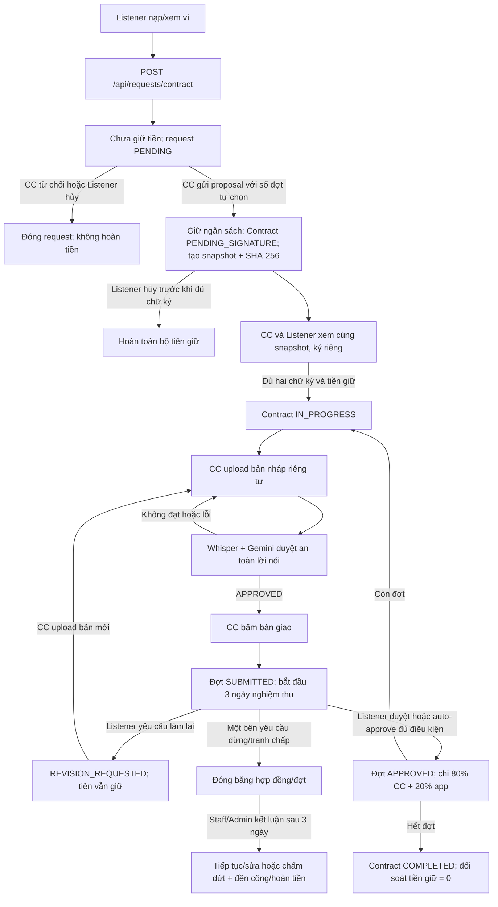

# Luồng hợp đồng Listener đặt CC sản xuất audio/video

Tài liệu này giải thích chức năng chạy theo thứ tự nào và tiền đi đâu. [Hướng dẫn Frontend gọi API](CONTRACT_API_GUIDE.md) chứa URL, body, response. [Mẫu hợp đồng](CONTRACT_TEMPLATE.md) là nội dung được đóng gói để tạo snapshot ký.

## 1. Các bên và điều khoản

Listener chọn ngân sách VND, đặt CC làm một sản phẩm audio/video. CC **tự chọn số đợt** từ một đợt trở lên; tổng tiền các đợt phải đúng ngân sách. Mỗi bản bàn giao cho Listener **3 ngày** nghiệm thu; Listener có tối đa **3 lượt yêu cầu làm lại mỗi đợt**. Đợt được duyệt: CC nhận **80%**, nền tảng **20%** trong ngân sách đã giữ. Với tranh chấp mới, bên còn lại có **3 ngày để xác nhận**; nếu xác nhận thì Staff xử lý, nếu không thì bên mở thắng. Luồng chấm dứt cũ đã mở trước thay đổi vẫn có quy tắc đền công 30% đợt đủ điều kiện, phí app 10% từ phần CC. Listener chỉ sử dụng và đăng tải sản phẩm đã nghiệm thu, thanh toán đủ cho mục đích **phi thương mại**.

## 2. Luồng request hợp đồng có giữ tiền

### Tạo yêu cầu và giữ ngân sách khi CC đề xuất

Listener nhập tên, mô tả, kênh CC, AUDIO/VIDEO, định dạng file, thời lượng, tiêu chí nghiệm thu, ngân sách và tùy chọn tự nghiệm thu. `POST /api/requests/contract` lưu request `PENDING`, chưa trừ ví. `idempotencyKey` giúp retry cùng nội dung không tạo request mới. Khi CC gửi đề xuất hợp lệ, Backend khóa ví Listener, chuyển đúng ngân sách từ `availableBalance` sang `heldBalance`, lưu bút toán và tạo hợp đồng trong một transaction. Nếu lúc đó không đủ tiền, đề xuất thất bại, request vẫn `PENDING` và CC có thể thử lại sau khi Listener nạp tiền. Nếu CC từ chối hoặc Listener hủy trước đề xuất thì không có tiền cần hoàn; nếu hủy sau đề xuất nhưng trước khi hợp đồng có hiệu lực, Backend hoàn tiền giữ vào số dư khả dụng.

### CC đề xuất và hai bên ký

CC tự chọn số đợt từ một đợt trở lên, ghi tên, mô tả, hạn nộp tăng dần và tiền cho từng đợt. Backend kiểm tra tổng bằng ngân sách Listener đề xuất, giữ tiền, tạo `Contract PENDING_SIGNATURE`, sinh bảng giai đoạn đúng số đợt, lưu snapshot hợp đồng và hash SHA-256. Listener và CC đọc cùng `contentSnapshot`, ký bằng phiên bản/hash đã xem. Backend lưu thời điểm từng bên ký. Chỉ khi đủ hai chữ ký và tiền giữ vẫn đủ, hợp đồng mới `IN_PROGRESS`. CC chưa thể nộp file trước thời điểm này. API `/accept` cũ bị chặn đối với request có escrow.

### CC bàn giao, Listener phản hồi

Sau khi CC tạo hợp đồng, Listener và CC có thể trao đổi riêng trong chat của request để làm rõ yêu cầu hoặc hỏi tiến độ. Tin nhắn được lưu và gửi realtime đến hai bên; người ngoài hợp đồng không đọc/gửi được. Chat vẫn mở khi hợp đồng chờ ký, đang thực hiện hoặc đang tranh chấp; khi hoàn tất/hủy/chấm dứt thì chỉ đọc lịch sử. Tin nhắn không tự sửa hợp đồng hoặc nghĩa vụ thanh toán.

CC upload bản nháp audio/video cho đợt hiện tại; Backend lưu object key riêng tư, giữ nguyên trạng thái đợt và chạy Whisper + Gemini kiểm duyệt **an toàn của lời nói**. Nếu AI trả `SAFE` + `APPROVE` và confidence đạt ngưỡng cấu hình, bản nháp thành `APPROVED`; các kết quả khác hoặc lỗi đều không mở bàn giao. CC có thể upload bản mới. Nếu muốn quay lại bản trước đã duyệt, CC hủy bản nháp mới nhất; worker AI đang chạy không thể ghi đè trạng thái hủy. AI không đánh giá hình ảnh video hay chất lượng/tiêu chí sản phẩm. Khi bản nháp mới nhất chưa hủy được AI duyệt, CC **bấm bàn giao**; lúc đó mới tạo submission, đợt thành `SUBMITTED` và Listener mới lấy URL file có chữ ký R2. Chỉ được bàn giao đợt tiếp theo sau khi đợt trước `APPROVED`.

Khi đợt `SUBMITTED`, Listener chọn:

1. **Duyệt:** Backend trừ tiền gộp của đợt khỏi ngân sách giữ một lần, cộng phần ròng vào ví CC, ghi phí nền tảng và các bút toán; `Payment PAID`. Listener không trả thêm.
2. **Từ chối bản bàn giao hoặc yêu cầu sửa:** Phải có lý do; đợt `REVISION_REQUESTED`, tiền vẫn giữ. CC làm lại, upload bản mới, chờ AI duyệt rồi bấm bàn giao; đồng hồ 3 ngày bắt đầu lại từ lần bàn giao mới. Tổng cộng tối đa 3 lượt Listener yêu cầu trên mỗi đợt. Từ chối bản nộp không tự chấm dứt hợp đồng hay trả đền công.
3. **Tranh chấp:** Listener hoặc CC mở cho một đợt. Đợt `DISPUTED`, không tự nghiệm thu. Bên kia nhận thông báo realtime và có 3 ngày xác nhận. Không xác nhận thì người mở thắng; xác nhận thì Staff quyết định, Admin cũng xem được. Dù bên nào thắng, hợp đồng chấm dứt. Listener thắng được hoàn toàn bộ escrow còn giữ; CC thắng nhận 80% toàn bộ escrow còn giữ, app ghi phí 20%.

Người mở có thể rút tranh chấp khi bên kia chưa xác nhận và chưa hết 3 ngày. Khi rút, Backend khôi phục trạng thái hợp đồng/đợt trước tranh chấp, không động đến tiền và thông báo cho bên kia. Hồ sơ đã xác nhận hoặc đã kết luận không thể tự rút.

Nếu Listener đã chọn `autoAcceptEnabled=true` từ lúc tạo request, job Backend kiểm tra mỗi phút. Job chỉ tự duyệt sau **3 ngày** kể từ bản nộp mới nhất khi đợt vẫn `SUBMITTED`, hợp đồng đang hiệu lực, không có phản hồi/từ chối/sửa hay tranh chấp. Nếu `false`, không tự duyệt.

Ví dụ đợt **20.000 VND** được duyệt: CC nhận **16.000 VND**, app nhận **4.000 VND**. Tiền VND nguyên được làm tròn phí theo `HALF_UP`; phần CC bằng tiền gộp trừ phí, nên tổng luôn khớp.

### Dừng hợp đồng, đền công, hoàn tiền

Listener hoặc CC mở tranh chấp toàn hợp đồng. Hợp đồng chuyển `DISPUTED`, các bước nghiệm thu/giải ngân bị chặn, tiền còn lại ở ví giữ. Bên kia được thông báo realtime và có **3 ngày** để xác nhận. Nếu không xác nhận, người mở thắng tự động. Nếu xác nhận, Staff quyết định `LISTENER_WINS` hoặc `CREATOR_WINS`; Admin cũng xem và xử lý được. Khi có bên thắng, hợp đồng thành `TERMINATED`, các đợt chưa hoàn thành thành `CANCELLED`. Listener thắng được hoàn **100% số dư escrow còn lại**; CC thắng nhận **80% số dư escrow còn lại**, app ghi **20% phí**. Các khoản đã giải ngân trước đó không bị chi hoặc hoàn lại lần nữa. Mọi kết quả gửi thông báo hai bên và ghi lịch sử ví/thanh toán.

**Luồng chấm dứt cũ** đã mở trước thay đổi này vẫn dùng quyết định đền công sau 3 ngày:

- **Không đủ điều kiện đền công:** Hoàn toàn bộ ngân sách còn giữ cho Listener.
- **Đủ điều kiện:** Admin chỉ định `qualifyingSubmissionId` của đợt hiện tại và ghi `evidenceNote` chứng minh sản phẩm đáp ứng tiêu chí tối thiểu. Backend trả khoản đền công gộp bằng **30% giá trị đợt**, app lấy **10% từ khoản đền công này**, CC nhận phần ròng; hoàn tất cả phần còn giữ cho Listener. Các đợt đã duyệt và trả trước đó giữ nguyên.

Ví dụ Listener chọn **100.000 VND**, đợt hiện tại **40.000 VND**, chưa đợt nào đã duyệt: nếu Admin quyết định có đền công, khoản gộp **12.000 VND**; phí app **1.200 VND**; CC nhận **10.800 VND**; Listener được hoàn **88.000 VND**. Nếu chưa có bản nộp đủ điều kiện, Admin chọn không đền công và Listener nhận lại **100.000 VND**.

## 3. Luồng cũ vẫn tồn tại

`POST /api/requests` và CC `/accept` là luồng cũ: chỉ lưu `requestFee`, tạo Contract ngay, không giữ tiền, không có chữ ký, `/approve` chỉ tạo `Payment PENDING`. Frontend làm chức năng hợp đồng mới phải dùng **`POST /api/requests/contract` và `/proposal`**. Backend ngăn `/accept` cũ nhận request có escrow.

## 4. Giới hạn xác minh trước khi dùng tiền thật

Code đã compile và có unit test cho giữ ngân sách, tổng các đợt, chữ ký, chia tiền, phân quyền chat và các nhánh tranh chấp chính. **Chưa chạy integration test PostgreSQL/R2/WebSocket cho thay đổi mới**. Migration schema nằm ở `Backend/src/main/resources/db/migrations/`: `contract_escrow_workflow.sql`, `contract_chat.sql` và `dispute_confirmation.sql`; chưa chạy migration mới trên database dùng chung. Trước khi phát hành cần chạy migration đã kiểm tra trên môi trường riêng và test giao dịch đồng thời, rollback, retry, presigned URL, WebSocket và đối soát lịch sử ví trên một PostgreSQL test riêng.
