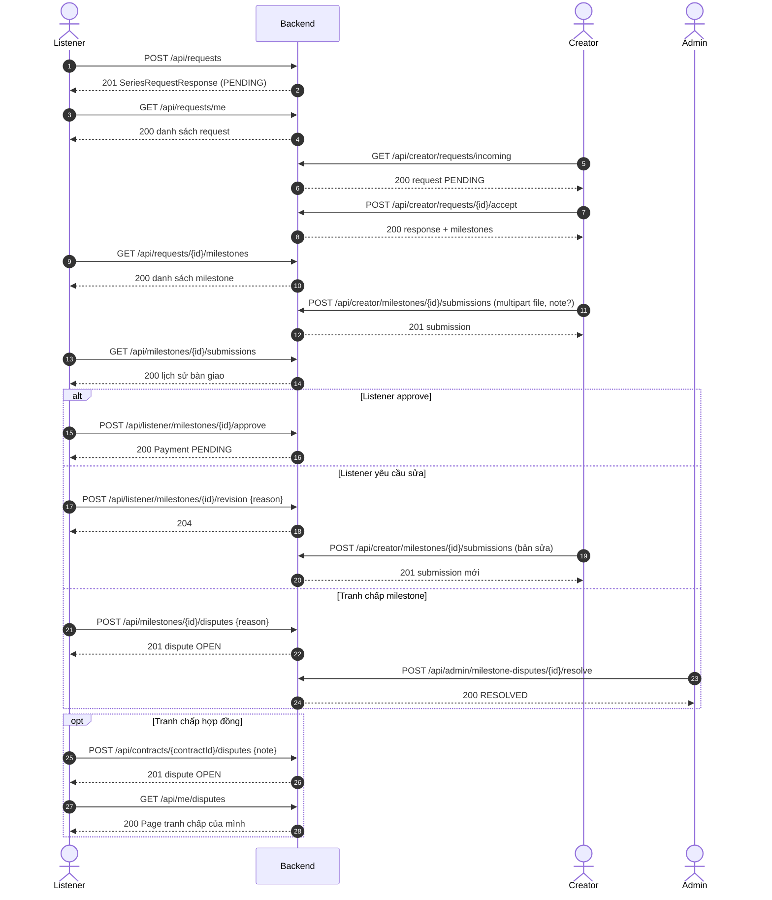
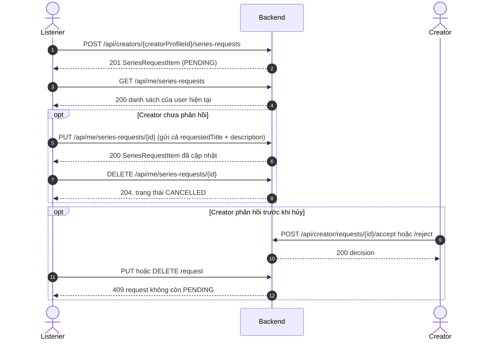
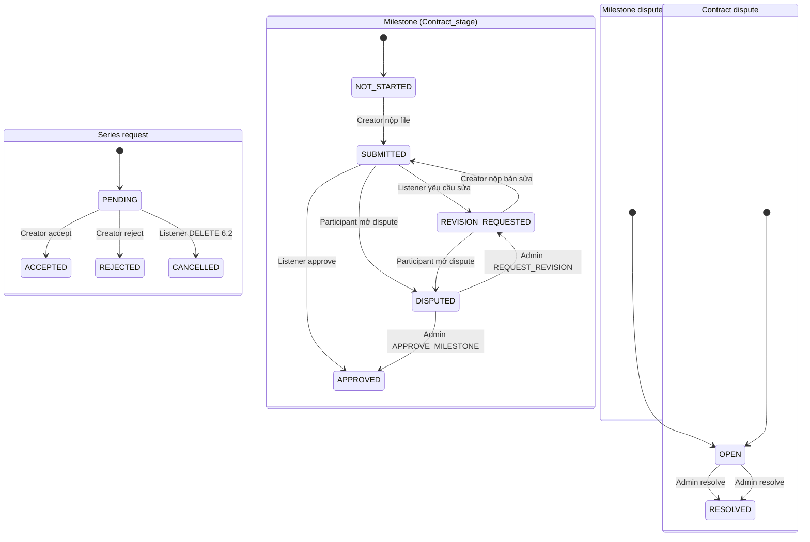

# Báo cáo chi tiết luồng Creator request của Listener

**Thời điểm kiểm thử cuối:** 2026-10-28, khoảng 18:00:00–18:00:30 (+07:00)  
**Phạm vi:** mục 6.1 và 6.2 của [README Listener](./listener/README.md), đối chiếu trực tiếp với backend và integration tests hiện có.  
**Kết quả lần chạy cuối:** `mvn test` **FAIL**, exit code 1: 19 tests, 17 pass, 2 fail, 0 errors, 0 skipped.

## Mục lục

1. [Tóm tắt điều hành](#1-tóm-tắt-điều-hành)
2. [Phạm vi và vai trò](#2-phạm-vi-và-vai-trò)
3. [Sơ đồ luồng và trạng thái](#3-sơ-đồ-luồng-và-trạng-thái)
4. [Chi tiết API](#4-chi-tiết-api)
5. [Mô hình dữ liệu](#5-mô-hình-dữ-liệu)
6. [Ma trận phân quyền](#6-ma-trận-phân-quyền)
7. [Quy tắc nghiệp vụ và trạng thái](#7-quy-tắc-nghiệp-vụ-và-trạng-thái)
8. [Giao điểm với thanh toán](#8-giao-điểm-với-thanh-toán)
9. [Kiểm thử](#9-kiểm-thử)
10. [Lỗi và sai lệch đã phát hiện](#10-lỗi-và-sai-lệch-đã-phát-hiện)
11. [Hạn chế và việc còn lại](#11-hạn-chế-và-việc-còn-lại)
12. [Hướng dẫn demo thủ công](#12-hướng-dẫn-demo-thủ-công)
13. [Phụ lục](#13-phụ-lục)
14. [Điểm cần tôi xác nhận](#14-điểm-cần-tôi-xác-nhận)

## 1. Tóm tắt điều hành

- Backend có hai cách tạo yêu cầu: 6.1 có đề xuất ngân sách, Creator accept/reject, hợp đồng và milestone; 6.2 là yêu cầu gọn với title/description.
- 6.1 đi tới submission, approve hoặc revision, và có cả tranh chấp milestone/hợp đồng.
- 6.2 dùng chung bảng `Series_request`; khi Creator accept, request có thể tiếp tục qua luồng hợp đồng/milestone 6.1.
- Lần chạy cuối dùng integration tests Spring Boot + PostgreSQL test: 17/19 pass, 2 fail; không được gọi là pass toàn suite.
- Hai lỗi runtime: Creator role vẫn POST được yêu cầu 6.2 (201 thay vì test kỳ vọng 403); note bàn giao 5.001 ký tự trả 409 thay vì test kỳ vọng 400.
- Code còn có dấu hiệu không nhất quán: contract chuyển `AWAITING_PAYMENT` khi duyệt hết milestone, nhưng Admin reconciliation không cho trạng thái đó; chưa có test xác nhận.
- Không sửa production trong nhiệm vụ báo cáo này. Không chạy/mô tả mục 7; chỉ nêu giao điểm payment được yêu cầu.

## 2. Phạm vi và vai trò

| Vai trò      | Trách nhiệm trong luồng                                                                                                                          | Bằng chứng                                                                                                                                                                                                                                                                                                                                                                            |
| ------------ | ------------------------------------------------------------------------------------------------------------------------------------------------ | ------------------------------------------------------------------------------------------------------------------------------------------------------------------------------------------------------------------------------------------------------------------------------------------------------------------------------------------------------------------------------------- |
| **Listener** | Gửi và theo dõi request; xem milestone/submission; approve, yêu cầu revision hoặc mở dispute; có thể mở dispute hợp đồng với tư cách thành viên. | [SeriesRequestController](../Backend/src/main/java/com/prmteam7/podcasthistory/controller/SeriesRequestController.java), [ListenerMilestoneController](../Backend/src/main/java/com/prmteam7/podcasthistory/controller/ListenerMilestoneController.java), [MyAdminCaseController](../Backend/src/main/java/com/prmteam7/podcasthistory/controller/MyAdminCaseController.java)         |
| **Creator**  | Xem inbox request `PENDING`; accept/reject; lập báo giá theo milestone; upload sản phẩm hoặc bản sửa.                                            | [CreatorRequestController](../Backend/src/main/java/com/prmteam7/podcasthistory/controller/CreatorRequestController.java), [CreatorMilestoneController](../Backend/src/main/java/com/prmteam7/podcasthistory/controller/CreatorMilestoneController.java)                                                                                                                              |
| **Admin**    | Xem/giải quyết milestone dispute và contract dispute; có endpoint reconciliation payment thủ công tại giao điểm với thanh toán.                  | [AdminMilestoneDisputeController](../Backend/src/main/java/com/prmteam7/podcasthistory/controller/AdminMilestoneDisputeController.java), [AdminDisputeController](../Backend/src/main/java/com/prmteam7/podcasthistory/controller/AdminDisputeController.java), [AdminFinanceController](../Backend/src/main/java/com/prmteam7/podcasthistory/controller/AdminFinanceController.java) |

**Khi chọn nhóm API:** dùng 6.1 nếu request cần Creator báo giá theo milestone, cần lưu hợp đồng và có các bước bàn giao/duyệt. Dùng 6.2 nếu chỉ cần gửi title/description và cho phép Listener tự sửa/hủy trước khi Creator phản hồi. Hai API tạo request khác nhau nhưng cùng lưu `Series_request`; một request 6.2 được Creator accept qua API Creator có thể tạo contract/stages như 6.1.

## 3. Sơ đồ luồng và trạng thái

### 3.1 Sequence 6.1



`reject` là nhánh thay thế `accept`: Creator gọi `POST /api/creator/requests/{id}/reject`; request chuyển `REJECTED` và không tạo contract/milestone. API này có trong code nhưng chưa được gọi trong happy-path test.

### 3.2 Sequence 6.2



### 3.3 State diagram



Các transition được rút từ service; trạng thái được lưu dưới dạng chuỗi. `CANCELLED` được ghi bởi service nhưng không có trong enum `RequestStatus`. Dispute milestone chỉ kiểm tra không có dispute `OPEN`; khi dispute được xử lý, status về `RESOLVED`. Contract dispute lưu trạng thái hợp đồng trước khi chuyển `DISPUTED`.

## 4. Chi tiết API

### 4.1 API 6.1 — request, báo giá, milestone

Response DTO được trả trực tiếp (List/Page/record), không có lớp bọc `data`. Những dòng ghi `409 role/service` là do `PodcastWorkflowException` được ánh xạ thành Conflict; không đồng nghĩa role luôn bị chặn thành 403.

| Method + path                                            | Vai trò gọi                                                       | Request body / validation                                                                                                                                                                                                      | Response và success                                                                                                                                                                                                                                                                                 | Lỗi / điều kiện chính                                                                                                                                                                                                              | Controller → service                                                                                                                                                                                                                                                                        | Bảng đọc / ghi                                                                                                          |
| -------------------------------------------------------- | ----------------------------------------------------------------- | ------------------------------------------------------------------------------------------------------------------------------------------------------------------------------------------------------------------------------ | --------------------------------------------------------------------------------------------------------------------------------------------------------------------------------------------------------------------------------------------------------------------------------------------------- | ---------------------------------------------------------------------------------------------------------------------------------------------------------------------------------------------------------------------------------- | ------------------------------------------------------------------------------------------------------------------------------------------------------------------------------------------------------------------------------------------------------------------------------------------- | ----------------------------------------------------------------------------------------------------------------------- |
| `POST /api/requests`                                     | Listener theo nghiệp vụ                                           | `creatorProfileId` bắt buộc UUID; `requestedTitle` nonblank ≤220; `description` nonblank ≤5.000; `requestFee` tùy chọn ≥0, tối đa 10 chữ số nguyên + 2 lẻ; `currency` tùy chọn 3 chữ cái ASCII.                                | **201** `SeriesRequestResponse`: `requestId`, `listenerId`, `creatorProfileId`, `creatorChannelName`, `title`, `description`, `proposedBudget`, `currency`, `status`, `createdAt`, `respondedAt`. Fee null thành `0.00`; currency null/blank thành `USD`, giá trị truyền vào được trim + uppercase. | **400** validation; **401** thiếu/invalid token; **404** Creator profile không tồn tại; **409** user không hoạt động/sai role/Creator không có role phù hợp qua service.                                                           | [SeriesRequestController.create](../Backend/src/main/java/com/prmteam7/podcasthistory/controller/SeriesRequestController.java) → [PodcastRequestService.createRequest](../Backend/src/main/java/com/prmteam7/podcasthistory/service/PodcastRequestService.java), `createRequest`            | Đọc `User`, `Producer_profile`; ghi `Series_request`.                                                                   |
| `GET /api/requests/me`                                   | Listener theo nghiệp vụ                                           | Không body.                                                                                                                                                                                                                    | **200** `List<SeriesRequestResponse>` của Listener hiện tại.                                                                                                                                                                                                                                        | **401** chưa xác thực; sai role service trả **409**.                                                                                                                                                                               | [SeriesRequestController.getMine](../Backend/src/main/java/com/prmteam7/podcasthistory/controller/SeriesRequestController.java) → [PodcastRequestService.getListenerRequests](../Backend/src/main/java/com/prmteam7/podcasthistory/service/PodcastRequestService.java)                      | Đọc `User`, `Series_request`, `Producer_profile`.                                                                       |
| `GET /api/creator/requests/incoming`                     | Creator có profile                                                | Không body.                                                                                                                                                                                                                    | **200** `List<SeriesRequestResponse>` chỉ request `PENDING` gửi tới Creator.                                                                                                                                                                                                                        | **401** chưa xác thực; **403** role khác do `/api/creator/**`; profile thiếu/sai role trong service có thể thành **409**.                                                                                                          | [CreatorRequestController.getIncoming](../Backend/src/main/java/com/prmteam7/podcasthistory/controller/CreatorRequestController.java) → [PodcastRequestService.getCreatorInbox](../Backend/src/main/java/com/prmteam7/podcasthistory/service/PodcastRequestService.java)                    | Đọc `User`, `Producer_profile`, `Series_request`.                                                                       |
| `POST /api/creator/requests/{requestId}/accept`          | Creator sở hữu request                                            | `responseText` nonblank ≤5.000; `milestones` 1–30; mỗi item: `name` nonblank ≤150, `description` tùy chọn ≤3.000, `amount` bắt buộc ≥0.01, tối đa 10 chữ số nguyên + 2 lẻ. Tổng và từng amount bị kiểm tra tiếp trong service. | **200** `SeriesRequestDecisionResponse`: `request`, `responseText`, `milestones[]`; milestone có `milestoneId`, `name`, `description`, `order`, `amount`, `currency`, `status`, `paymentId`.                                                                                                        | **400** body/field validation; **401** token; **403** role khác qua security; **404** request không tồn tại; **409** request không thuộc Creator, không `PENDING`, hoặc tổng tiền vượt giới hạn.                                   | [CreatorRequestController.accept](../Backend/src/main/java/com/prmteam7/podcasthistory/controller/CreatorRequestController.java) → [PodcastRequestService.acceptRequest](../Backend/src/main/java/com/prmteam7/podcasthistory/service/PodcastRequestService.java)                           | Đọc/lock `Series_request`; ghi `Series_response`, `Contract`, `Contract_stage`; cập nhật request status/responded time. |
| `POST /api/creator/requests/{requestId}/reject`          | Creator sở hữu request                                            | `responseText` nonblank ≤5.000.                                                                                                                                                                                                | **200** `SeriesRequestDecisionResponse`; `milestones` rỗng, `request.status=REJECTED`.                                                                                                                                                                                                              | **400**, **401**, **403**, **404**, **409** (owner/status) như accept.                                                                                                                                                             | [CreatorRequestController.reject](../Backend/src/main/java/com/prmteam7/podcasthistory/controller/CreatorRequestController.java) → [PodcastRequestService.rejectRequest](../Backend/src/main/java/com/prmteam7/podcasthistory/service/PodcastRequestService.java)                           | Đọc/lock và cập nhật `Series_request`; ghi `Series_response`.                                                           |
| `GET /api/requests/{requestId}/milestones`               | Listener hoặc Creator là participant                              | Không body.                                                                                                                                                                                                                    | **200** `List<MilestoneResponse>`; `paymentId` null trước khi Payment được tạo.                                                                                                                                                                                                                     | **401** token; **404** request không tồn tại; **409** role không phải participant, user không thuộc request, hoặc request chưa được accept.                                                                                        | [SeriesRequestController.getMilestones](../Backend/src/main/java/com/prmteam7/podcasthistory/controller/SeriesRequestController.java) → [PodcastRequestService.getRequestMilestones](../Backend/src/main/java/com/prmteam7/podcasthistory/service/PodcastRequestService.java)               | Đọc `Series_request`, `Contract`, `Contract_stage`, `Payment`.                                                          |
| `POST /api/creator/milestones/{milestoneId}/submissions` | Creator thuộc contract                                            | `multipart/form-data`: `file` bắt buộc; `note` tùy chọn, code kiểm tra ≤5.000 ký tự (không phải bean-validation DTO).                                                                                                          | **201** `MilestoneSubmissionResponse`: `submissionId`, `milestoneId`, `revisionNumber`, `objectKey`, `publicUrl`, `contentType`, `note`, `submittedAt`.                                                                                                                                             | **400** thiếu file/body, file upload không hợp lệ; **401** token; **403** role khác qua security; **404** milestone không tồn tại; **409** sai participant/state hoặc note >5.000; hạ tầng upload có thể **502/503** theo handler. | [CreatorMilestoneController.submit](../Backend/src/main/java/com/prmteam7/podcasthistory/controller/CreatorMilestoneController.java) → [PodcastRequestService.submitMilestone](../Backend/src/main/java/com/prmteam7/podcasthistory/service/PodcastRequestService.java)                     | Đọc/lock `Contract_stage`, đếm/ghi `Milestone_submission`; cập nhật stage status. Upload media là side effect ngoài DB. |
| `GET /api/milestones/{milestoneId}/submissions`          | Listener/Creator là participant; Admin được service cho phép      | Không body.                                                                                                                                                                                                                    | **200** `List<MilestoneSubmissionResponse>` theo revision number tăng dần.                                                                                                                                                                                                                          | **401** token; **404** stage không tồn tại; **409** role participant không hợp lệ hoặc user không tham gia.                                                                                                                        | [MilestoneDisputeController.getSubmissions](../Backend/src/main/java/com/prmteam7/podcasthistory/controller/MilestoneDisputeController.java) → [PodcastRequestService.getMilestoneSubmissions](../Backend/src/main/java/com/prmteam7/podcasthistory/service/PodcastRequestService.java)     | Đọc `Contract_stage`, `Milestone_submission`, `User`.                                                                   |
| `POST /api/listener/milestones/{milestoneId}/approve`    | Listener sở hữu request                                           | Không body. Chỉ khi stage `SUBMITTED`.                                                                                                                                                                                         | **200** `MilestoneApprovalResponse`: `milestoneId`, `milestoneStatus`, `paymentId`, `paymentStatus`, `amount`, `currency`, `message`.                                                                                                                                                               | **400** không có body không phát sinh; **401** token; **403** không phải Listener qua security; **404** milestone không tồn tại; **409** không phải Listener của contract, stage không `SUBMITTED`, hoặc Payment đã có.            | [ListenerMilestoneController.approve](../Backend/src/main/java/com/prmteam7/podcasthistory/controller/ListenerMilestoneController.java) → [PodcastRequestService.approveMilestone](../Backend/src/main/java/com/prmteam7/podcasthistory/service/PodcastRequestService.java)                 | Đọc/lock `User`, `Contract_stage`, `Contract`; ghi `Payment`; cập nhật stage và có thể cập nhật contract.               |
| `POST /api/listener/milestones/{milestoneId}/revision`   | Listener sở hữu request                                           | `reason` nonblank ≤5.000; chỉ stage `SUBMITTED`.                                                                                                                                                                               | **204** không response body.                                                                                                                                                                                                                                                                        | **400** validation; **401**, **403** sai role qua security, **404** stage không tồn tại, **409** sai owner/state.                                                                                                                  | [ListenerMilestoneController.requestRevision](../Backend/src/main/java/com/prmteam7/podcasthistory/controller/ListenerMilestoneController.java) → [PodcastRequestService.requestMilestoneRevision](../Backend/src/main/java/com/prmteam7/podcasthistory/service/PodcastRequestService.java) | Đọc/lock `Contract_stage`; ghi `Milestone_revision`; cập nhật stage.                                                    |
| `POST /api/milestones/{milestoneId}/disputes`            | Listener/Creator participant                                      | `reason` nonblank ≤5.000. Stage phải `SUBMITTED` hoặc `REVISION_REQUESTED`.                                                                                                                                                    | **201** `DisputeResponse`: `disputeId`, `milestoneId`, `raisedByUserId`, `reason`, `status`, `decision`, `resolutionNote`, `reviewedByUserId`, `createdAt`, `resolvedAt`.                                                                                                                           | **400** validation; **401** token; **404** stage không tồn tại; **409** sai participant/role/state hoặc đã có dispute `OPEN`.                                                                                                      | [MilestoneDisputeController.raiseDispute](../Backend/src/main/java/com/prmteam7/podcasthistory/controller/MilestoneDisputeController.java) → [PodcastRequestService.raiseDispute](../Backend/src/main/java/com/prmteam7/podcasthistory/service/PodcastRequestService.java)                  | Đọc/lock `Contract_stage`, `User`, `Milestone_dispute`; ghi `Milestone_dispute`, cập nhật stage.                        |
| `POST /api/contracts/{contractId}/disputes`              | Listener/Creator participant; service cũng cho Admin              | `note` nonblank ≤5.000.                                                                                                                                                                                                        | **201** `AdminResponses.DisputeItem`: `disputeId`, `contractId`, `openedById`, `reason`, `previousContractStatus`, `status`, `decision`, `note`, `reviewerId`, `createdAt`, `resolvedAt`.                                                                                                           | **400** validation; **401** token; **403** không phải participant; **404** contract không tồn tại; **409** contract đã có dispute `OPEN` hoặc contract state không được phép.                                                      | [MyAdminCaseController.open](../Backend/src/main/java/com/prmteam7/podcasthistory/controller/MyAdminCaseController.java) → [AdminDisputeService.open](../Backend/src/main/java/com/prmteam7/podcasthistory/service/AdminDisputeService.java)                                                | Đọc/lock `Contract`, `User`, `Contract_dispute`; ghi dispute; cập nhật contract; audit/notifications.                   |
| `GET /api/me/disputes?page=0&size=20`                    | Tài khoản đã xác thực; chỉ trả các contract dispute mình tham gia | Không body.                                                                                                                                                                                                                    | **200** `Page<DisputeItem>`: `content`, `pageable`, `totalElements`, `totalPages`, …                                                                                                                                                                                                                | **401** token; lỗi phân trang phụ thuộc page helper. Không thấy role Listener bắt buộc ở service.                                                                                                                                  | [MyAdminCaseController.mine](../Backend/src/main/java/com/prmteam7/podcasthistory/controller/MyAdminCaseController.java) → [AdminDisputeService.mine](../Backend/src/main/java/com/prmteam7/podcasthistory/service/AdminDisputeService.java)                                                | Đọc `Contract_dispute`, `Contract`, `User`, `Producer_profile`.                                                         |

**Nhánh Admin xử lý tranh chấp:** `GET /api/admin/milestone-disputes/open` + `POST /api/admin/milestone-disputes/{disputeId}/resolve` xử lý `MilestoneDispute`; `GET /api/admin/disputes`/`{id}` + `POST /api/admin/disputes/{id}/resolve` xử lý `ContractDispute`. Các route `/api/admin/**` yêu cầu Admin, nhưng SecurityConfig cho một số route Admin khác cả Staff; các route tranh chấp này đi qua matcher Admin chung. Milestone resolve body là `decision` (`APPROVE_MILESTONE` hoặc `REQUEST_REVISION`) và `note` nonblank ≤5.000; kết quả mặc định **200**. Contract resolve dùng `decision` thuộc `DisputeDecision`, `note` nonblank ≤5.000; **200**. Chi tiết contract resolve: [AdminDisputeController](../Backend/src/main/java/com/prmteam7/podcasthistory/controller/AdminDisputeController.java), [AdminDisputeService](../Backend/src/main/java/com/prmteam7/podcasthistory/service/AdminDisputeService.java).

### 4.2 API 6.2 — yêu cầu đơn giản

| Method + path                                    | Vai trò được mô tả / thực tế                                                                                    | Request body / validation                                                         | Response và success                                                                                                                                                                                                                                                                                                                 | Lỗi / điều kiện chính                                                                                                                                                                                                              | Controller → service/method                                                                                                                                                                                                                                                  | Bảng đọc / ghi                                                               |
| ------------------------------------------------ | --------------------------------------------------------------------------------------------------------------- | --------------------------------------------------------------------------------- | ----------------------------------------------------------------------------------------------------------------------------------------------------------------------------------------------------------------------------------------------------------------------------------------------------------------------------------- | ---------------------------------------------------------------------------------------------------------------------------------------------------------------------------------------------------------------------------------- | ---------------------------------------------------------------------------------------------------------------------------------------------------------------------------------------------------------------------------------------------------------------------------- | ---------------------------------------------------------------------------- |
| `POST /api/creators/{creatorId}/series-requests` | Theo tài liệu là Listener; **code hiện không kiểm tra role người gửi**. Creator token đã được test và nhận 201. | `requestedTitle` nonblank ≤220; `description` nonblank ≤10.000.                   | **201** `SeriesRequestItem`: `seriesRequestId`, `creatorProfileId`, `creatorChannelName`, `requestedTitle`, `description`, `requestFee`, `currency`, `status`, `createdAt`, `respondedAt`, `creatorResponse`, `creatorResponseStatus`. Fee bằng 0; currency là membership plan currency nếu membership tồn tại, nếu không là `VND`. | **400** validation; **401** thiếu/invalid token; **404** Creator không tồn tại/chưa approved hoặc user không hoạt động; **403** thiếu membership chỉ khi cờ membership bật; role sai hiện không bị từ chối — test Creator trả 201. | [ListenerFlowController.createSeriesRequest](../Backend/src/main/java/com/prmteam7/podcasthistory/controller/ListenerFlowController.java) → [ListenerFlowService.createSeriesRequest](../Backend/src/main/java/com/prmteam7/podcasthistory/service/ListenerFlowService.java) | Đọc `Producer_profile`, `User`, có thể `Subscription`; ghi `Series_request`. |
| `GET /api/me/series-requests`                    | Bất kỳ authenticated role đều qua route; lọc theo user ID trong token, không có role check riêng.               | Không body.                                                                       | **200** `List<SeriesRequestItem>` thuộc user hiện tại.                                                                                                                                                                                                                                                                              | **401** chưa xác thực/invalid token; không xem danh sách user khác vì query theo token user ID.                                                                                                                                    | [ListenerFlowController.getSeriesRequests](../Backend/src/main/java/com/prmteam7/podcasthistory/controller/ListenerFlowController.java) → [ListenerFlowService.getSeriesRequests](../Backend/src/main/java/com/prmteam7/podcasthistory/service/ListenerFlowService.java)     | Đọc `Series_request`, `Series_response`, `Producer_profile`.                 |
| `PUT /api/me/series-requests/{requestId}`        | Bất kỳ authenticated role, nhưng chỉ owner được cập nhật theo kiểm tra service.                                 | Phải gửi lại cả `requestedTitle` nonblank ≤220 và `description` nonblank ≤10.000. | **200** `SeriesRequestItem` sau cập nhật.                                                                                                                                                                                                                                                                                           | **400** validation; **401** token; **403** user khác owner; **404** ID không tồn tại; **409** request không còn `PENDING`.                                                                                                         | [ListenerFlowController.updateSeriesRequest](../Backend/src/main/java/com/prmteam7/podcasthistory/controller/ListenerFlowController.java) → [ListenerFlowService.updateSeriesRequest](../Backend/src/main/java/com/prmteam7/podcasthistory/service/ListenerFlowService.java) | Đọc/ghi `Series_request`.                                                    |
| `DELETE /api/me/series-requests/{requestId}`     | Bất kỳ authenticated role, nhưng chỉ owner được hủy theo kiểm tra service.                                      | Không body.                                                                       | **204**; service đặt status chuỗi `CANCELLED`.                                                                                                                                                                                                                                                                                      | **401** token; **403** user khác owner; **404** ID không tồn tại; **409** request không còn `PENDING`.                                                                                                                             | [ListenerFlowController.cancelSeriesRequest](../Backend/src/main/java/com/prmteam7/podcasthistory/controller/ListenerFlowController.java) → [ListenerFlowService.cancelSeriesRequest](../Backend/src/main/java/com/prmteam7/podcasthistory/service/ListenerFlowService.java) | Đọc/ghi `Series_request`.                                                    |

### 4.3 Mã lỗi chung và cấu trúc lỗi

[GlobalExceptionHandler](../Backend/src/main/java/com/prmteam7/podcasthistory/exception/GlobalExceptionHandler.java) ánh xạ `MethodArgumentNotValidException` và request parse/type error sang **400**; `ResourceNotFoundException`/`PodcastWorkflowNotFoundException` sang **404**; `ResourceForbiddenException` sang **403**; `ResourceConflictException`/`PodcastWorkflowException` và database conflict sang **409**. Authentication/authorization filter trả **401/403**. Body lỗi là `ApiError`: `timestamp`, `status`, `error`, `message`. Vì cùng một nghiệp vụ có thể dùng exception class khác nhau, không suy ra tất cả ownership violations sẽ có cùng status.

## 5. Mô hình dữ liệu

| Entity / bảng (JPA table)                        | Cột/thuộc tính chính và ràng buộc                                                                                                                                                                                                                                                                               | Quan hệ / vai trò                                                                                                |
| ------------------------------------------------ | --------------------------------------------------------------------------------------------------------------------------------------------------------------------------------------------------------------------------------------------------------------------------------------------------------------- | ---------------------------------------------------------------------------------------------------------------- |
| `SeriesRequest` / `"Series_request"`             | `series_request_id` UUID; `user_id`, `producer_profile_id` bắt buộc; `requested_title` varchar(220); `description` text; `request_fee` numeric(12,2); `currency` char(3); `status` varchar(30); `responded_at`; timestamps từ Base/UpdatedEntity; index theo user và creator profile.                           | Gốc cho cả hai cách gửi. Link Listener `User`, `ProducerProfile`.                                                |
| `RequestResponse` / `"Series_response"`          | response ID; `series_request_id` one-to-one; `producer_profile_id`; `response_text` text; `response_status`.                                                                                                                                                                                                    | Phản hồi accept/reject của Creator; request response được dùng làm liên kết Contract.                            |
| `Contract` / `"Contract"`                        | `contract_id`; `user_id`; `producer_profile_id`; `series_response_id` unique; `status`; timestamps/indexes.                                                                                                                                                                                                     | Liên kết request đã phản hồi với Listener, Creator và các stage.                                                 |
| `ContractStage` / `"Contract_stage"`             | `contract_stage_id`; `contract_id`; `stage_name` varchar(150); `description`; `stage_order`; `status`; `amount` numeric(12,2); unique `(contract_id, stage_order)`.                                                                                                                                             | Một contract có các milestone/stage.                                                                             |
| `MilestoneSubmission` / `"Milestone_submission"` | ID; `contract_stage_id`; `creator_user_id`; `revision_number`; `object_key`; `public_url`; `content_type` varchar(150); `submission_note`; `submitted_at`; index stage.                                                                                                                                         | Lịch sử các bản bàn giao cho một stage.                                                                          |
| `MilestoneRevision` / `"Milestone_revision"`     | ID; `contract_stage_id`; `requested_by_user_id`; `revision_number`; `reason`; unique `(contract_stage_id, revision_number)`.                                                                                                                                                                                    | Ghi nhận revision request từ Listener hoặc Admin.                                                                |
| `MilestoneDispute` / `"Milestone_dispute"`       | ID; `contract_stage_id`; người mở; `reason`; `status`; người review; `decision`; `resolution_note`; `resolved_at`; indexes status/stage.                                                                                                                                                                        | Tranh chấp gắn với stage; trạng thái `OPEN`/`RESOLVED`.                                                          |
| `ContractDispute` / `"Contract_dispute"`         | `dispute_id`; `contract_id`; `opened_by_id`; `reason`; `previous_contract_status`; `status`; `decision`; `note`; reviewer/resolved time; index status + created_at.                                                                                                                                             | Tranh chấp cả hợp đồng, tách biệt với milestone dispute.                                                         |
| `Payment` / `"Payment"`                          | ID; payer `user_id`; một trong `subscription_id`, `series_request_id`, `contract_stage_id`; amount numeric(12,2); currency char(3); payment method/provider/transaction/payment code; status/paid_at. JPA check yêu cầu đúng một liên kết business; migration tạo unique partial index cho `contract_stage_id`. | Approve milestone tạo Payment qua `contract_stage_id`; provider/paymentCode không được gán trong method tạo này. |

Các entity tương ứng: [SeriesRequest](../Backend/src/main/java/com/prmteam7/podcasthistory/model/SeriesRequest.java), [RequestResponse](../Backend/src/main/java/com/prmteam7/podcasthistory/model/RequestResponse.java), [Contract](../Backend/src/main/java/com/prmteam7/podcasthistory/model/Contract.java), [ContractStage](../Backend/src/main/java/com/prmteam7/podcasthistory/model/ContractStage.java), [MilestoneSubmission](../Backend/src/main/java/com/prmteam7/podcasthistory/model/MilestoneSubmission.java), [MilestoneRevision](../Backend/src/main/java/com/prmteam7/podcasthistory/model/MilestoneRevision.java), [MilestoneDispute](../Backend/src/main/java/com/prmteam7/podcasthistory/model/MilestoneDispute.java), [ContractDispute](../Backend/src/main/java/com/prmteam7/podcasthistory/model/ContractDispute.java), [Payment](../Backend/src/main/java/com/prmteam7/podcasthistory/model/Payment.java).

**Migration:** migration [2026-10-13_podcast_request_milestones.sql](../Backend/db/migrations/2026-10-13_podcast_request_milestones.sql) thêm amount cho stage, liên kết Payment-stage, submission/revision/milestone-dispute và unique index cho một Payment mỗi stage. [2026-10-13_admin_operations.sql](../Backend/db/migrations/2026-10-13_admin_operations.sql) tạo bảng contract dispute. Vì các migration cần thiết đã có trong repo, không thấy yêu cầu tạo migration mới để mô tả schema hiện tại; **chưa xác định** các migration đó đã được áp dụng lên mọi môi trường database hay chưa. Test profile dùng Hibernate `create-drop`, không phải kiểm chứng quy trình migrate production.

## 6. Ma trận phân quyền

| Route family                                       | Listener                                                 | Creator                                                                                         | Admin                                                                                           | Cơ chế và mã lỗi đã xác minh                                                                                                                                  |
| -------------------------------------------------- | -------------------------------------------------------- | ----------------------------------------------------------------------------------------------- | ----------------------------------------------------------------------------------------------- | ------------------------------------------------------------------------------------------------------------------------------------------------------------- |
| `/api/requests`                                    | Được phép theo service                                   | Sai role bị service từ chối; do exception mapping hiện là **409**, không phải route matcher 403 | Sai role tương tự nếu gọi POST; GET mine filter theo user nhưng service bắt role Listener       | `SecurityConfig` chỉ yêu cầu authenticated; `PodcastRequestService` kiểm tra role/active user.                                                                |
| `/api/creator/**`                                  | **403**                                                  | Được phép; service tiếp tục xác minh sở hữu request/profile                                     | **403** qua matcher `/api/creator/**`                                                           | `SecurityConfig.hasRole("CREATOR")`; sai resource owner/state thường là **409** từ service.                                                                   |
| `/api/listener/**`                                 | Được phép; service kiểm tra đúng Listener sở hữu request | **403** qua matcher `/api/listener/**`                                                          | **403** qua matcher                                                                             | Security role matcher; stage owner/state mismatch trong service là **409**.                                                                                   |
| `/api/milestones/{id}/submissions`, `/disputes`    | Chỉ participant; không participant **409**               | Chỉ participant; không participant **409**                                                      | Submission GET được service cho phép; mở dispute không được Admin role cho phép, thường **409** | Các route không nằm trong `/api/listener/**` hay `/api/creator/**`; service xác minh participant/role.                                                        |
| `/api/creators/{id}/series-requests`               | POST hoạt động (201)                                     | POST cũng hoạt động (test xác nhận 201); **không có role check**                                | Code không có role check cho POST; runtime Admin chưa test                                      | `anyRequest().authenticated()`, service kiểm tra user active và Creator đích nhưng không role người gọi. Đây là lỗi mở.                                       |
| `/api/me/series-requests/**`                       | Owner được xem/sửa/hủy; update/delete chỉ khi pending    | Owner token cũng được áp dụng tương tự; test chưa thử POST sai-role cho GET/PUT/DELETE          | Code không có role restriction riêng, nhưng owner check vẫn áp dụng                             | Owner mismatch **403**, ID thiếu **404**, sai state **409**.                                                                                                  |
| `/api/contracts/{id}/disputes`, `/api/me/disputes` | Participant được mở/xem tranh chấp của mình              | Participant được mở/xem                                                                         | `AdminDisputeService.open` cho phép Admin mở; mine chỉ lọc participant                          | Contract owner mismatch **403**; request không tồn tại **404**; trùng/state conflict **409**.                                                                 |
| `/api/admin/**`                                    | **403**                                                  | **403**                                                                                         | Được phép nếu active Admin                                                                      | Security matcher; service cũng kiểm tra Admin. Một số route Admin tổng quát cho Staff nhưng route dispute/payment trong bảng này nằm dưới Admin-only matcher. |

Token sai/hết hạn thường **401**. `AccountJwtValidator` còn xác thực user tồn tại/active, role, token version và access token. Xem [SecurityConfig](../Backend/src/main/java/com/prmteam7/podcasthistory/config/SecurityConfig.java) và [AccountJwtValidator](../Backend/src/main/java/com/prmteam7/podcasthistory/config/AccountJwtValidator.java).

## 7. Quy tắc nghiệp vụ và trạng thái

1. 6.1 tạo request ở `PENDING`; Creator chỉ accept/reject khi request còn `PENDING`, thuộc đúng Creator profile. Accept tạo response, contract `IN_PROGRESS` và từ 1 tới 30 stages `NOT_STARTED`.
2. 6.2 tạo request `PENDING`; `PUT` gửi lại đủ title + description, `DELETE` đặt chuỗi status `CANCELLED`. Cả hai chỉ được khi `PENDING`; sau khi Creator accept/reject thì request không còn pending và update/cancel trả **409**.
3. Creator chỉ nộp stage ở `NOT_STARTED` hoặc `REVISION_REQUESTED`; upload thành công ghi submission với revision number tiếp theo và chuyển sang `SUBMITTED`.
4. Listener approve hoặc revision chỉ được khi stage `SUBMITTED` và Listener là bên đã tạo request. Approve tạo một Payment duy nhất cho stage, stage thành `APPROVED`; revision ghi `Milestone_revision` và stage thành `REVISION_REQUESTED`.
5. Participant có thể mở milestone dispute khi stage `SUBMITTED` hoặc `REVISION_REQUESTED`, nếu chưa có dispute `OPEN`; mở dispute chuyển stage thành `DISPUTED`. Admin giải quyết về `APPROVED` (tạo Payment) hoặc `REVISION_REQUESTED`.
6. Contract dispute chỉ mở khi contract ở trạng thái `PENDING`, `ACTIVE`, `IN_PROGRESS`, `ACCEPTED`, `SIGNED` hoặc `CREATED`; một contract không được có dispute `OPEN` đồng thời. Mở tranh chấp lưu trạng thái cũ rồi đặt contract `DISPUTED`.
7. Khi `features.memberships-enabled=false`, 6.2 không truy vấn/đòi membership; test profile cũng đặt cờ này. Khi bật, `createSeriesRequest` yêu cầu subscription `ACTIVE` còn hiệu lực của đúng channel, nếu không trả **403**.
8. Validation lỗi từ DTO thường **400**. Một số quy tắc trạng thái hoặc validation được ném dưới dạng `PodcastWorkflowException` nên trả **409**; ví dụ note submission quá dài.
9. Request/milestone status lưu dạng `String`; enum `RequestStatus` chỉ khai báo `PENDING`, `ACCEPTED`, `REJECTED`, trong khi code ghi thêm `CANCELLED` cho 6.2. Đây là bất nhất enum/schema-contract, dù test đọc được `CANCELLED`.
10. Khi tất cả stage được approve, `PodcastRequestService` đặt contract thành `AWAITING_PAYMENT`. Tuy nhiên Admin finance reconciliation hiện chỉ cho contract `ACTIVE`, `IN_PROGRESS`, `COMPLETED`; xem thêm mục [8](#8-giao-điểm-với-thanh-toán). Đây là rủi ro luồng có thể mắc ở milestone cuối.

## 8. Giao điểm với thanh toán

`POST /api/listener/milestones/{milestoneId}/approve` chỉ hợp lệ khi stage đã `SUBMITTED`; service tạo `Payment` với payer là Listener/contract user, `contract_stage_id`, amount/currency của stage/request và `status=PENDING`. Method này **không gán `provider` hoặc `paymentCode`**. Integration happy-path kiểm tra DB rằng payment là `PENDING`, `provider=null`, `paymentCode=null`; đây là assertion test, không phải dự đoán QR/provider. Xem [PodcastRequestService.createPendingPayment](../Backend/src/main/java/com/prmteam7/podcasthistory/service/PodcastRequestService.java) và [test luồng approve](../Backend/src/test/java/com/prmteam7/podcasthistory/CreatorRequestWorkflowIntegrationTest.java).

Có endpoint reconciliation thủ công của Admin: `POST /api/admin/payments/{paymentId}/reconcile`, body `result` (`PAID`/`FAILED`), `providerTransactionId`, `note`. Trong nhánh `PAID`, payment chuyển `PAID` và provider đặt `MANUAL_TRANSFER`. Tuy nhiên code status có bất nhất: approve cuối cùng làm contract thành `AWAITING_PAYMENT`, trong khi reconciliation đòi contract ở `ACTIVE`, `IN_PROGRESS` hoặc `COMPLETED`. Vì vậy payment của milestone cuối có khả năng không reconcile được. **Chưa có integration test cho nhánh reconciliation của milestone**, nên ghi đây là vấn đề suy ra trực tiếp từ guard trong code, chưa xác minh runtime. Không đánh giá các luồng khác ngoài giao điểm này.

## 9. Kiểm thử

### 9.1 Kết quả lần chạy cuối

| Lệnh / suite                            | Kết quả                   |                                           Số lượng |
| --------------------------------------- | ------------------------- | -------------------------------------------------: |
| `mvn test`                              | **FAIL**, exit code **1** | 19 total: 17 pass, 2 failures, 0 errors, 0 skipped |
| `CreatorRequestDisputeIntegrationTest`  | PASS                      |                                             3 pass |
| `CreatorRequestWorkflowIntegrationTest` | FAIL                      |                                     3 pass, 1 fail |
| `SimpleCreatorRequestIntegrationTest`   | FAIL                      |                                     3 pass, 1 fail |
| `SepayServiceTest`                      | PASS                      |     8 pass; test cũ, không thuộc chức năng 6.1/6.2 |

Lệnh chạy bắt đầu khoảng **18:00:00** và Surefire XML suite cuối được ghi khoảng **18:00:30**, ngày **2026-10-28** theo giờ local +07:00. Hai assertion fail:

- `reportsOversizedSubmissionNoteAsBadRequest`: kỳ vọng **400**, response thực là **409**.
- `simpleRequestEndpointRejectsCreatorRole`: kỳ vọng **403**, response thực là **201**.

### 9.2 Ánh xạ test method → API/quy tắc

| Test class + method                                                                                         | API/quy tắc được kiểm tra                                                                                                                                                       | Kết quả               |
| ----------------------------------------------------------------------------------------------------------- | ------------------------------------------------------------------------------------------------------------------------------------------------------------------------------- | --------------------- |
| `CreatorRequestWorkflowIntegrationTest.completesContractRequestHandoffAndPendingApprovalFlow`               | 6.1 POST request → GET mine → Creator accept → GET stages → submission → GET submissions → approve; dữ liệu contract/milestone và Payment `PENDING`, provider/paymentCode null. | PASS                  |
| `CreatorRequestWorkflowIntegrationTest.rejectsInvalidContractRequestPayloadsWithBadRequest`                 | 6.1 title/description rỗng/quá dài; fee âm, vượt 10 chữ số nguyên, quá 2 chữ số thập phân; currency sai độ dài; kỳ vọng 400 và không persist request.                           | PASS                  |
| `CreatorRequestWorkflowIntegrationTest.validatesAuthorizationWorkflowStateAndRevisionReason`                | 6.1 ownership request/milestone, stage chưa submitted, unauthenticated, revision reason; expected statuses 401/409/400 theo từng tình huống.                                    | PASS                  |
| `CreatorRequestWorkflowIntegrationTest.reportsOversizedSubmissionNoteAsBadRequest`                          | Submission multipart với note 5.001 ký tự; kỳ vọng 400.                                                                                                                         | **FAIL: thực tế 409** |
| `CreatorRequestDisputeIntegrationTest.enforcesMilestoneDisputeOwnershipValidationAndNoDuplicateOpenDispute` | Reason rỗng/quá dài, người không tham gia, mở dispute hợp lệ, duplicate open dispute.                                                                                           | PASS                  |
| `CreatorRequestDisputeIntegrationTest.enforcesContractDisputeOwnerReasonAndDuplicateRules`                  | Contract dispute note rỗng/quá dài, owner, duplicate; GET `/api/me/disputes` chỉ thấy tranh chấp thuộc user.                                                                    | PASS                  |
| `CreatorRequestDisputeIntegrationTest.requiresAuthenticationForRequestAndDisputeEndpoints`                  | Thiếu token ở request/dispute GET trả 401.                                                                                                                                      | PASS                  |
| `SimpleCreatorRequestIntegrationTest.createsUpdatesListsAndCancelsRequestWithoutMembership`                 | 6.2 POST/GET/PUT/DELETE với membership disabled; update gửi cả hai trường; owner isolation; cancel status `CANCELLED`.                                                          | PASS                  |
| `SimpleCreatorRequestIntegrationTest.rejectsInvalidSimpleRequestAndUpdateFields`                            | Title/description rỗng hoặc quá giới hạn ở POST/PUT; kỳ vọng 400.                                                                                                               | PASS                  |
| `SimpleCreatorRequestIntegrationTest.refusesUpdateAndCancelAfterCreatorHasResponded`                        | Creator accept; Listener PUT/DELETE request không còn pending nhận 409.                                                                                                         | PASS                  |
| `SimpleCreatorRequestIntegrationTest.simpleRequestEndpointRejectsCreatorRole`                               | Gửi POST 6.2 với access token Creator, test kỳ vọng 403.                                                                                                                        | **FAIL: thực tế 201** |

### 9.3 Cách chạy và giới hạn

- Chạy từ `Backend`: `mvn test`.
- Integration tests bật profile `test`, dùng PostgreSQL test riêng, `ddl-auto=create-drop`, và mock `DatabaseSeeder`/media upload; fixture được tạo trong test transaction.
- Cần cấu hình cục bộ các biến `TEST_DB_URL`, `TEST_DB_USERNAME`, `TEST_DB_PASSWORD` trỏ tới database test riêng; tên database phải có `test` theo URL safety guard. Có thể đặt `TEST_JWT_SECRET` theo cấu hình test nếu cần; **không ghi giá trị hoặc credential vào báo cáo/chat**.
- Cấu hình riêng nằm ở [application-test.properties](../Backend/src/test/resources/application-test.properties); shared fixture và URL guard ở [CreatorRequestIntegrationTestBase](../Backend/src/test/java/com/prmteam7/podcasthistory/CreatorRequestIntegrationTestBase.java).
- `mvn test` tạo schema từ entity bằng Hibernate `create-drop`; không xác minh migration upgrade trên database hiện hữu.
- Chưa có test riêng cho: Creator reject; Admin dispute resolve; contract dispute Admin resolution; payment reconcile của milestone; nhiều milestone và hành vi stage cuối; concurrent request/dispute; file storage thật; mọi loại tài khoản inactive/role mismatch; paginated edge cases; HTTP deployment/proxy/runtime Swagger.
- Không chạy `Backend/scripts/api_regression.py` trong phạm vi này.

## 10. Lỗi và sai lệch đã phát hiện

| #   | Mức độ | Mô tả / bằng chứng                                                                                                                                                                                                                                                                                                                     | Trạng thái                         | File liên quan                                                                                                                                                                                                                                                                                                                                                                                                                                                               |
| --- | ------ | -------------------------------------------------------------------------------------------------------------------------------------------------------------------------------------------------------------------------------------------------------------------------------------------------------------------------------------- | ---------------------------------- | ---------------------------------------------------------------------------------------------------------------------------------------------------------------------------------------------------------------------------------------------------------------------------------------------------------------------------------------------------------------------------------------------------------------------------------------------------------------------------- |
| 1   | MEDIUM | Creator token gọi `POST /api/creators/{creatorId}/series-requests` nhận **201**, vì controller route không bị matcher role giới hạn và `ListenerFlowService.createSeriesRequest` không kiểm tra role người gửi. Test kỳ vọng 403. Admin cũng không bị role check trong service nhưng chưa runtime test.                                | **Còn mở**                         | [ListenerFlowController](../Backend/src/main/java/com/prmteam7/podcasthistory/controller/ListenerFlowController.java), [ListenerFlowService](../Backend/src/main/java/com/prmteam7/podcasthistory/service/ListenerFlowService.java), [SecurityConfig](../Backend/src/main/java/com/prmteam7/podcasthistory/config/SecurityConfig.java), [SimpleCreatorRequestIntegrationTest](../Backend/src/test/java/com/prmteam7/podcasthistory/SimpleCreatorRequestIntegrationTest.java) |
| 2   | LOW    | Note submission dài 5.001 ký tự trả **409**, do service ném `PodcastWorkflowException`; test kỳ vọng 400 cho input vượt giới hạn.                                                                                                                                                                                                      | **Còn mở**                         | [PodcastRequestService](../Backend/src/main/java/com/prmteam7/podcasthistory/service/PodcastRequestService.java), [GlobalExceptionHandler](../Backend/src/main/java/com/prmteam7/podcasthistory/exception/GlobalExceptionHandler.java), [CreatorRequestWorkflowIntegrationTest](../Backend/src/test/java/com/prmteam7/podcasthistory/CreatorRequestWorkflowIntegrationTest.java)                                                                                             |
| 3   | HIGH   | Khi tất cả milestone được approve, contract chuyển `AWAITING_PAYMENT`; Admin finance reconcile chỉ cho contract `ACTIVE`/`IN_PROGRESS`/`COMPLETED`. Với milestone cuối, nhánh reconcile PAID có thể bị **409**, khiến payment không thể hoàn tất qua endpoint hiện tại. Static code-path mismatch; chưa có test runtime cho nhánh này. | **Còn mở / cần xác minh**          | [PodcastRequestService](../Backend/src/main/java/com/prmteam7/podcasthistory/service/PodcastRequestService.java), [AdminFinanceService](../Backend/src/main/java/com/prmteam7/podcasthistory/service/AdminFinanceService.java), [AdminFinanceController](../Backend/src/main/java/com/prmteam7/podcasthistory/controller/AdminFinanceController.java)                                                                                                                        |
| 4   | LOW    | `RequestStatus` enum không có `CANCELLED`, nhưng service 6.2 ghi status này bằng literal string; test xác nhận endpoint trả/đọc được. Có thể gây lệch giữa enum, tài liệu và code ở nơi khác.                                                                                                                                          | **Còn mở**                         | [RequestStatus](../Backend/src/main/java/com/prmteam7/podcasthistory/enums/RequestStatus.java), [ListenerFlowService](../Backend/src/main/java/com/prmteam7/podcasthistory/service/ListenerFlowService.java), [SeriesRequest](../Backend/src/main/java/com/prmteam7/podcasthistory/model/SeriesRequest.java)                                                                                                                                                                 |
| 5   | INFO   | README mục 6.1 không liệt kê đầy đủ Creator inbox/accept/reject và Creator upload submission, dù đó là các bước cần để chạy luồng end-to-end. Tên response 6.1 và 6.2 cũng khác (`requestId` so với `seriesRequestId`; `proposedBudget` so với `requestFee`).                                                                          | **Tài liệu cần cập nhật**          | [README Listener mục 6](./listener/README.md), các controller/DTO nêu ở mục 4                                                                                                                                                                                                                                                                                                                                                                                                |
| 6   | INFO   | 6.1 default currency trong service là `USD`, còn 6.2 tạo request với `VND` nếu membership disabled. README chỉ nói currency 6.1 tùy chọn 3 chữ cái, chưa nêu default.                                                                                                                                                                  | **Tài liệu cần cập nhật/xác nhận** | [PodcastRequestService](../Backend/src/main/java/com/prmteam7/podcasthistory/service/PodcastRequestService.java), [ListenerFlowService](../Backend/src/main/java/com/prmteam7/podcasthistory/service/ListenerFlowService.java), [README Listener](./listener/README.md)                                                                                                                                                                                                      |
| 7   | INFO   | File `docs/creator-request-api-audit.md` được nhắc trong yêu cầu trước đó nhưng hiện không có trong workspace tìm kiếm; vì vậy không thể đối chiếu hay khẳng định các phát hiện cụ thể của audit cũ. Nội dung sai lệch ở báo cáo này dựa trên mục 6 README + source/test hiện tại.                                                     | **Chưa xác định**                  | Không tìm thấy file audit tại workspace.                                                                                                                                                                                                                                                                                                                                                                                                                                     |

Các lỗi 1–2 là hai failure của lần chạy `mvn test` mới nhất và cũng được ghi trong [test report trước đó](./creator-request-test-report.md). Lỗi 3–4 là phát hiện khi đối chiếu code hiện tại; không được tính là test failure đã chạy.

## 11. Hạn chế và việc còn lại

| Ưu tiên | Việc tiếp theo                                                                                                                                                      | Phụ trách đề xuất                                                    | Lý do                                                                                     |
| ------- | ------------------------------------------------------------------------------------------------------------------------------------------------------------------- | -------------------------------------------------------------------- | ----------------------------------------------------------------------------------------- |
| P1      | Quyết định và bổ sung giới hạn role Listener cho POST 6.2 (hoặc xác nhận Creator/Admin được phép gửi request), sau đó cập nhật expectation/test và chạy lại.        | Backend owner / product owner xác nhận chính sách; Backend implement | Runtime hiện Creator POST thành công.                                                     |
| P1      | Thống nhất trạng thái hợp đồng dùng khi mọi milestone được duyệt với guard của Admin payment reconciliation; thêm test flow approve hết → reconcile milestone cuối. | Backend payment + request workflow owners                            | Potential 409 làm payment cuối mắc ở PENDING.                                             |
| P2      | Chọn status chuẩn cho note quá dài (400 validation hoặc 409 conflict) và thống nhất service exception/test/spec.                                                    | Backend owner                                                        | Hiện thực tế 409, test kỳ vọng 400.                                                       |
| P2      | Đưa `CANCELLED` vào enum hoặc dùng trạng thái chuẩn hiện hữu; kiểm tra persistence/query/analytics có phụ thuộc enum.                                               | Backend owner                                                        | Trạng thái hiện ghi bằng chuỗi ngoài enum.                                                |
| P2      | Cập nhật README mục 6 để có đầy đủ Creator endpoints, request/response field names, default currencies và status transitions; bổ sung default/null behavior.        | Tài liệu/API owner                                                   | Tài liệu hiện chưa thể hiện toàn bộ quy trình code.                                       |
| P3      | Bổ sung kiểm thử Admin dispute resolve, Creator reject, concurrent duplicate/open, inactive account và upload storage integration.                                  | QA/backend                                                           | Bộ test hiện dùng mock upload, không xác minh tích hợp storage thật.                      |
| P3      | Xác nhận các migration workflow đã được áp dụng ở từng môi trường.                                                                                                  | Database/release owner                                               | Repo có migration nhưng test create-drop không chứng minh trạng thái database triển khai. |

Không có thay đổi production/test được thực hiện khi lập báo cáo này; các đề xuất chỉ để ưu tiên xử lý.

## 12. Hướng dẫn demo thủ công

Mở Swagger của backend đang chạy tại `/swagger-ui/index.html`. Dùng placeholder UUID/token; không paste token hoặc dữ liệu thật vào tài liệu này. Trong Swagger, Authorize bằng token tương ứng từng actor.

### 12.1 Demo 6.1

1. **Listener — tạo request**: `POST /api/requests`.

   ```json
   {
     "creatorProfileId": "<CREATOR_PROFILE_UUID>",
     "requestedTitle": "Podcast lịch sử địa phương",
     "description": "Nội dung và thời lượng mong muốn",
     "requestFee": 0,
     "currency": "VND"
   }
   ```

   Response rút gọn: `201 {"requestId":"<REQUEST_UUID>","status":"PENDING","proposedBudget":0.00,...}`.

2. **Listener — xem request**: `GET /api/requests/me`; lấy `requestId`.
3. **Creator — xem inbox**: `GET /api/creator/requests/incoming`.
4. **Creator — accept và báo giá**: `POST /api/creator/requests/<REQUEST_UUID>/accept`.

   ```json
   {
     "responseText": "Tôi nhận thực hiện",
     "milestones": [
       { "name": "Bản nháp", "description": "Bản bàn giao đầu", "amount": 100 }
     ]
   }
   ```

   Response rút gọn có `request.status=ACCEPTED` và `milestones[0].milestoneId="<MILESTONE_UUID>"`.

5. **Listener — xem mốc**: `GET /api/requests/<REQUEST_UUID>/milestones`.
6. **Creator — nộp file**: `POST /api/creator/milestones/<MILESTONE_UUID>/submissions`; trong Swagger chọn multipart `file`, `note` tùy chọn.
7. **Listener — xem bàn giao**: `GET /api/milestones/<MILESTONE_UUID>/submissions`.
8. Chọn một nhánh:
   - Approve: `POST /api/listener/milestones/<MILESTONE_UUID>/approve`, không body. Kỳ vọng `200`, `milestoneStatus=APPROVED`, `paymentStatus=PENDING`.
   - Revision: `POST /api/listener/milestones/<MILESTONE_UUID>/revision`, body `{"reason":"Vui lòng chỉnh phần mở đầu"}`; kỳ vọng `204`. Sau đó Creator nộp lại file.
   - Dispute: khi stage `SUBMITTED` hoặc `REVISION_REQUESTED`, participant gọi `POST /api/milestones/<MILESTONE_UUID>/disputes` body `{"reason":"Cần Admin xem xét"}`; kỳ vọng `201`, `status=OPEN`.
9. Contract dispute (nếu cần): `POST /api/contracts/<CONTRACT_UUID>/disputes` body `{"note":"Đề nghị xem xét hợp đồng"}`; xem danh sách bằng `GET /api/me/disputes`.

Creator reject là nhánh khác với accept: `POST /api/creator/requests/<REQUEST_UUID>/reject` body `{"responseText":"Hiện chưa thể nhận yêu cầu này"}`; thực hiện trên request `PENDING`, không tạo stage.

### 12.2 Demo 6.2

1. **Listener token** — `POST /api/creators/<CREATOR_PROFILE_UUID>/series-requests`:

   ```json
   { "requestedTitle": "Chủ đề tập mới", "description": "Mô tả mong muốn" }
   ```

   Response `201` chứa `seriesRequestId`, status `PENDING`, `requestFee` và currency.

2. `GET /api/me/series-requests` để xác nhận request.
3. Khi còn `PENDING`, gọi `PUT /api/me/series-requests/<REQUEST_UUID>` với **cả hai trường**:

   ```json
   { "requestedTitle": "Chủ đề đã sửa", "description": "Mô tả đã cập nhật" }
   ```

4. Hoặc hủy khi còn `PENDING`: `DELETE /api/me/series-requests/<REQUEST_UUID>`, kỳ vọng `204`; GET lại để thấy `CANCELLED`.
5. Để chứng minh state guard, Creator accept/reject trước rồi gọi PUT/DELETE; kỳ vọng `409`.
6. Nếu dùng token Creator để POST 6.2, code hiện trả `201` (đã xác nhận bởi test fail). Không dùng dữ liệu thật; đây là reproduction của lỗi role đang mở, không phải hành vi được khuyến nghị.

## 13. Phụ lục

### 13.1 Danh sách file tạo trong phần kiểm thử luồng này

Đối chiếu read-only với `origin/main`: Git báo các test/resource/docs dưới đây là untracked trong workspace hiện tại; `git diff --name-only origin/main` không liệt kê file untracked, nên danh sách bổ sung từ `git status --short`. Không có production file nào được tạo/sửa trong phần test này.

| File                                                                                                                                          | Tình trạng trong phần kiểm thử                                               |
| --------------------------------------------------------------------------------------------------------------------------------------------- | ---------------------------------------------------------------------------- |
| [CreatorRequestIntegrationTestBase.java](../Backend/src/test/java/com/prmteam7/podcasthistory/CreatorRequestIntegrationTestBase.java)         | Tạo shared test fixture; đã chỉnh test harness để JWT/JPA fixture chạy được. |
| [CreatorRequestWorkflowIntegrationTest.java](../Backend/src/test/java/com/prmteam7/podcasthistory/CreatorRequestWorkflowIntegrationTest.java) | Tạo test workflow 6.1; đã chỉnh assertion BigDecimal trong test.             |
| [CreatorRequestDisputeIntegrationTest.java](../Backend/src/test/java/com/prmteam7/podcasthistory/CreatorRequestDisputeIntegrationTest.java)   | Tạo integration tests cho milestone/contract dispute.                        |
| [SimpleCreatorRequestIntegrationTest.java](../Backend/src/test/java/com/prmteam7/podcasthistory/SimpleCreatorRequestIntegrationTest.java)     | Tạo integration tests cho 6.2, membership off, state và role.                |
| [application-test.properties](../Backend/src/test/resources/application-test.properties)                                                      | Tạo cấu hình profile test `create-drop`, membership off.                     |
| [creator-request-test-plan.md](./creator-request-test-plan.md)                                                                                | Tạo kế hoạch test theo bước được duyệt.                                      |
| [creator-request-test-report.md](./creator-request-test-report.md)                                                                            | Tạo/cập nhật báo cáo test vòng trước; ghi hai runtime failures.              |
| [creator-request-flow-report.md](./creator-request-flow-report.md)                                                                            | File duy nhất được tạo cho nhiệm vụ báo cáo hiện tại.                        |

### 13.2 Spec so với code — cần cập nhật tài liệu

| Chủ đề               | Mục 6 README hiện ghi                                                             | Code hiện tại                                                                                             | Đề xuất cập nhật                                                                  |
| -------------------- | --------------------------------------------------------------------------------- | --------------------------------------------------------------------------------------------------------- | --------------------------------------------------------------------------------- |
| 6.1 Creator decision | Có mô tả Listener gửi/yêu cầu xem, nhưng bảng thiếu Creator inbox, accept/reject. | `GET /api/creator/requests/incoming`, POST accept/reject.                                                 | Thêm các API và JSON `AcceptSeriesRequest`/`RejectSeriesRequest`.                 |
| 6.1 upload           | Bảng liệt kê GET submissions nhưng không nêu Creator POST submission.             | Multipart POST Creator có `file` và `note` tùy chọn; status 201.                                          | Thêm upload, trạng thái hợp lệ, max note và lỗi thực tế 409 hiện nay.             |
| 6.1 response names   | Nêu requestId, status và milestoneId/paymentId.                                   | 6.1 response dùng `proposedBudget`; submission có revision/content fields; approve có `paymentStatus`.    | Tài liệu hóa các field response thật đầy đủ hơn.                                  |
| 6.1 currency default | Ghi currency tùy chọn 3 chữ cái.                                                  | Null/blank trở thành `USD`; normalize chữ hoa.                                                            | Ghi default và quy tắc trim/case.                                                 |
| 6.2 role             | Nằm trong phần Listener; ngữ nghĩa cho thấy Listener khởi tạo.                    | POST route không role matcher/service role-check; Creator token nhận 201.                                 | Quyết định role policy, rồi cập nhật code hoặc tài liệu/test sao cho nhất quán.   |
| 6.2 response/status  | Mô tả thao tác nhưng không chi tiết field response và enum states.                | Response field `seriesRequestId`, `requestFee`; hủy ghi `CANCELLED`, không có trong enum `RequestStatus`. | Thêm response/status list, đồng thời thống nhất enum.                             |
| Payment workflow     | 6.1 nói approve tạo Payment PENDING, chưa xác nhận thanh toán.                    | Test xác nhận pending; Admin reconciliation có status guard không gồm `AWAITING_PAYMENT`.                 | Mô tả bước xác nhận và sửa/đồng bộ state guard trước khi hứa hoàn tất thanh toán. |

## 14. Điểm cần tôi xác nhận

1. Chính sách mong muốn cho 6.2: chỉ Listener được POST hay Creator/Admin cũng được phép? Test hiện kỳ vọng Creator bị 403 nhưng backend trả 201.
2. Khi toàn bộ milestone đã approve, contract nên ở `AWAITING_PAYMENT` hay trạng thái khác để Admin reconciliation hoạt động? Guard payment hiện không chấp nhận `AWAITING_PAYMENT`.
3. Note submission vượt giới hạn nên chuẩn hóa thành 400 hay giữ 409? Test hiện yêu cầu 400, code trả 409.
4. Default currency của 6.1 có chủ đích là `USD` không, trong khi 6.2 mặc định `VND`?
5. Có thể cung cấp/khôi phục `docs/creator-request-api-audit.md` nếu cần đối chiếu chính xác các phát hiện của audit cũ; file không được tìm thấy trong workspace lúc lập báo cáo.
6. Xác nhận trạng thái `CANCELLED` là status nghiệp vụ chính thức để đưa vào `RequestStatus` enum hay nên dùng status khác.
